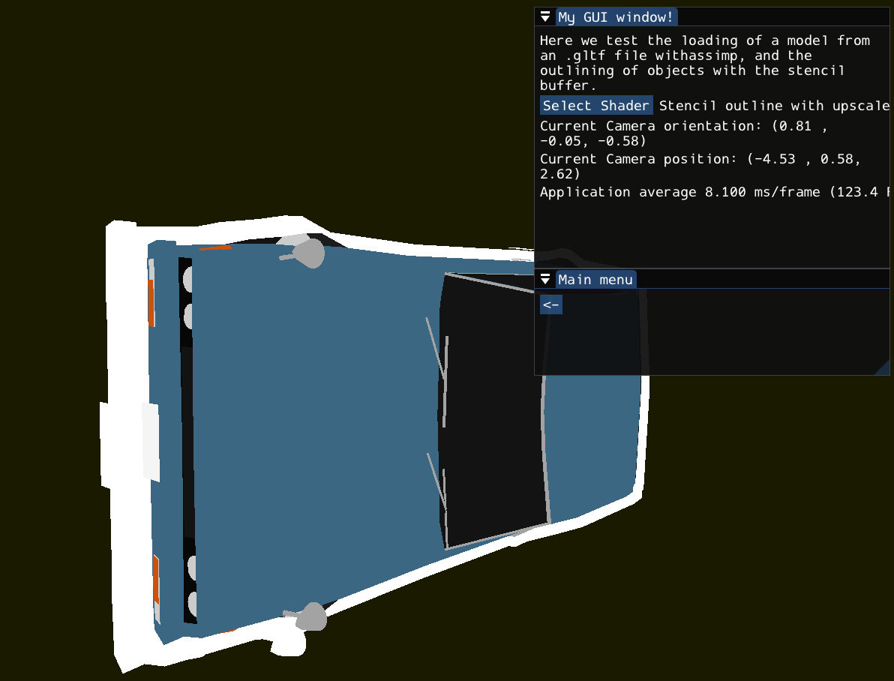
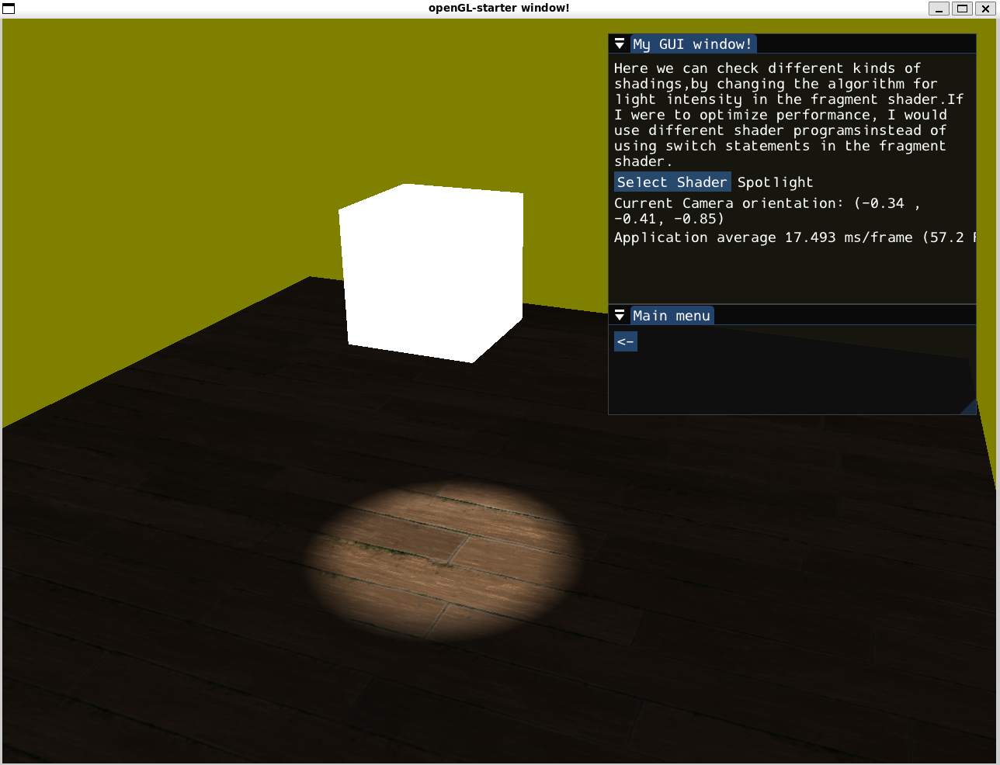

# Starter project for OpenGL projects

Multiple OpenGL examples can be selected from the start window, each describing an aspect of OpenGL
and graphics programming.

The code for each example can be easely read, making this project useful documentation for starting OpenGL projects.
Most have a GUI window describing what is going on.

I first followed [Cherno's openGL youtube series](https://www.youtube.com/watch?v=W3gAzLwfIP0&list=PLlrATfBNZ98foTJPJ_Ev03o2oq3-GGOS2)
for the basics and the testing framework, then followed [Victor Gordan's OpenGL series](https://www.youtube.com/watch?v=XpBGwZNyUh0&list=PLPaoO-vpZnumdcb4tZc4x5Q-v7CkrQ6M-)
for more in-depth concepts.

[CMake](https://cmake.org/) is used as the build tool, for easy import of external libraries.

Here is are a few screenshot examples:



## Compiling with Cmake and running

1. To set the build configuration, first run

```bash
cmake -S . -B build
```

2. To build the application, run

```bash
cmake --build build
```

3. Then run the generated binary file with

```bash
./build/bin/OpenGL-starter
```

## Documentation for OpenGL

Great site for OpenGL documentation: [docs.gl](https://docs.gl/gl3/glBufferData)

## About the 3rd party libraries in `vendor/`

- `glad` is used to search for OpenGL functions above 1.0
- `glfw` is used to open windows.
  I fetch it using FetchContent, and use the X11 **display server protocols** if running
  on WSL, or Wayland if running on another Linux distro.
  Wayland is faster and more secure, but isn't supported by WSL2.
- `glm` is used for math involving OpenGL
- `stb_image` is used to load images as textures
- [Dear Imgui](https://github.com/ocornut/imgui) is used as a simple GUI.
  According to its README, it "outputs optimized vertex buffers that you can render anytime in 3D-pipeline-enabled applications".
  Its advantage is being fast, **renderer agnostic**, and self-contained (no external dependencies)
  - I use the docking branch of ImGui in order to enable dockable windows.

  Making a GUI library by myself would have been a whole other learning curve.

- [`tinyobj`](https://github.com/tinyobjloader/tinyobjloader) is used to load OBJ files only.
  I wrote a custom loader which extracts tinyobj objects into vertices, indices, and a material (for a single shape).
  While OBJ is not a very oftenly seen file format anymore, it is helpful to learn how 3D meshes can be represented,
  as it is a text format (not unreadable binary).
- [`assimp` (Open Asset Import Library)](https://github.com/assimp/assimp)
  is used to load much more file formats, such as GLTF in an example.

## General vocabulary

- **Index Buffer**:
  Store vertex positions in order to remove duplicate memory of vertices when rendering multiple triangles
  with shared vertices.

- **Vector**:
  Can simply be a position on a screen

- **Projection Matrix**:
  Tells the window how to map the vertices to it.

- **MVP or PVM**:
  Model view projection matrix. Transformation pipeline that goes through each vertex.
  Model, view and projection are each a 4 by 4 matrix, and they all get multiplied in that order
  (actually PVM in OpenGL, MVP in DirectX due to row ordering)

- **Normalized divise coordinates**:
  Normalized space we can then map to the window. Normalized as in between +-1.

- **Projections**:
  Allow you to decide what your coordinate space is so you can render objects however you like (inside or outside screen),
  and worry about normalization later.
  Orthographic projecetion is usually used for 2D, as opposed to perspective projection which is used for 3D.

- **Model matrix**
  Way for us to simulate the model (vertex we're drawing). Represents the object transformation.

- **View/Camera matrix**
  View of the camera. Way for us to simulate a camera.

- **Material**
  Shader + uniforms
